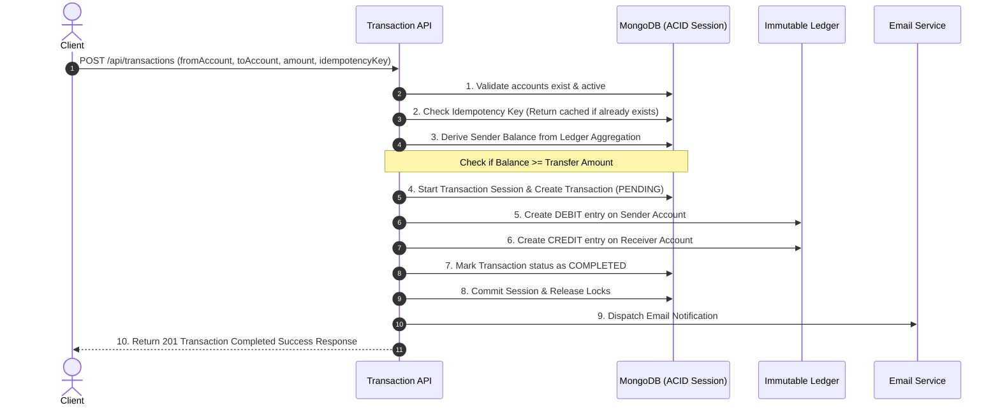

# Bank Transaction System Backend

A robust, production-grade **Bank Transaction and Double-Entry Ledger Backend** engineered with **Node.js**, **Express.js**, and **MongoDB**. Designed with financial engineering principles ensuring data integrity, idempotency, strict immutability, and ACID transactions.

---

## 🌟 Architecture & Key Features

### 1. Double-Entry Bookkeeping Ledger
* **Zero-Sum Accounting**: Every financial transaction generates corresponding and balancing `DEBIT` and `CREDIT` entries in an audit-grade ledger collection.
* **Strict Immutability**: Ledger entries cannot be modified, edited, or deleted once recorded. Schema-level pre-hooks prevent `findOneAndUpdate`, `updateOne`, `deleteOne`, `remove`, and other mutation operators.
* **Derived Balances**: Account balances are calculated dynamically using high-performance MongoDB aggregation pipelines (`$group` with sum of `CREDIT` minus `DEBIT`), avoiding stale cache vulnerabilities and race conditions.

### 2. ACID Transactions & Concurrency Control
* **Atomic Transfers**: Transactions run inside MongoDB Sessions with ACID compliance (`session.startTransaction()`). Any error or failure immediately rolls back all operations (pending records, debit/credit balance shifts).
* **Distributed Idempotency Protection**: Unique `idempotencyKey` indexed at database level prevents duplicate fund transfers under network retries, connection drops, or rapid button clicks.

### 3. The 10-Step Secure Transfer Flow
Every fund transfer strictly passes through the following sequential verification and execution pipeline:


### 4. Authentication, Authorization & Security
* **JWT Authentication**: Secure stateless token issuance with expiration support.
* **Token Blacklisting**: Logout system with automated MongoDB TTL (Time-To-Live) index that purges expired blacklisted tokens automatically after 3 days.
* **Role Separation**: Dedicated system user authorization middleware (`authSystemUserMiddleware`) to handle initial capital injections and internal fund allocations.
* **Bcrypt Password Security**: Robust password hashing with custom comparison instance methods.

---

## 🛠️ Tech Stack

* **Runtime:** [Node.js](https://nodejs.org/) (v18+)
* **Framework:** [Express.js](https://expressjs.com/) (v5)
* **Database & ODM:** [MongoDB](https://www.mongodb.com/) & [Mongoose](https://mongoosejs.com/)
* **Authentication:** [JSON Web Token (jsonwebtoken)](https://github.com/auth0/node-jsonwebtoken), [bcryptjs](https://github.com/dcodeIO/bcrypt.js)
* **Email Service:** [Nodemailer](https://nodemailer.com/) with Google OAuth2 support
* **Development Utilities:** [dotenv](https://github.com/motdotla/dotenv), [cookie-parser](https://github.com/expressjs/cookie-parser)

---

## 📁 Project Structure

```text
├── server.js                  # Application entry point & server boot
├── package.json               # Dependencies and scripts
├── .env.example               # Template environment configuration
├── .gitignore                 # Git ignore rules
└── src/
    ├── app.js                 # Express app initialization and route mounting
    ├── config/
    │   └── db.js              # MongoDB connection configuration
    ├── controllers/
    │   ├── account.controller.js       # Account creation & balance inquiry
    │   ├── auth.controller.js          # Register, login, and secure logout
    │   └── transaction.controller.js   # 10-step double-entry transfer engine
    ├── middleware/
    │   └── auth.middleware.js          # User auth & System user auth guards
    ├── models/
    │   ├── account.model.js            # Account schema with getBalance() aggregation
    │   ├── blackList.model.js          # Token blacklist with TTL index
    │   ├── ledger.model.js             # Immutable double-entry ledger entries
    │   ├── transaction.model.js        # Transaction records with idempotency key
    │   └── user.model.js               # User authentication model
    ├── routes/
    │   ├── account.routes.js           # Account endpoints
    │   ├── auth.routes.js              # Authentication endpoints
    │   └── transaction.routes.js       # Transaction & system funding endpoints
    └── services/
        └── email.service.js            # Automated email delivery service
```

---

## 🚀 Getting Started

### Prerequisites
* [Node.js](https://nodejs.org/) (v18 or higher recommended)
* [MongoDB](https://www.mongodb.com/) (Must be a Replica Set for ACID multi-document transactions; MongoDB Atlas free tier works out of the box)

### 1. Clone the repository
```bash
git clone https://github.com/MallaManoj/Bank-Transaction-System-Backend.git
cd Bank-Transaction-System-Backend
```

### 2. Install dependencies
```bash
npm install
```

### 3. Setup Environment Variables
Create a `.env` file in the root directory (refer to `.env.example`):
```env
PORT=3000
MONGO_URI=your_mongodb_replica_set_connection_string
JWT_SECRET=your_secure_jwt_secret
EMAIL_USER=your_email@gmail.com
CLIENT_ID=your_oauth2_client_id
CLIENT_SECRET=your_oauth2_client_secret
REFRESH_TOKEN=your_oauth2_refresh_token
```

### 4. Run the Application
```bash
# Production mode
npm start

# Development mode (with live reload)
npm run dev
```

---

## 📖 API Documentation

### Health Check
| Method | Endpoint | Description | Auth Required |
| :--- | :--- | :--- | :--- |
| `GET` | `/` | Health check endpoint | No |

---

### Authentication Routes (`/api/auth`)

#### 1. Register User
* **Endpoint:** `POST /api/auth/register`
* **Request Body:**
  ```json
  {
    "name": "Malla Manoj",
    "email": "manoj@example.com",
    "password": "securepassword123"
  }
  ```
* **Response (201 Created):**
  ```json
  {
    "user": {
      "_id": "6798031d74a2fc97e3a6c201",
      "email": "manoj@example.com",
      "name": "Malla Manoj"
    },
    "token": "eyJhbGciOiJIUzI1NiIsInR5cCI6..."
  }
  ```

#### 2. User Login
* **Endpoint:** `POST /api/auth/login`
* **Request Body:**
  ```json
  {
    "email": "manoj@example.com",
    "password": "securepassword123"
  }
  ```
* **Response (200 OK):**
  ```json
  {
    "user": {
      "_id": "6798031d74a2fc97e3a6c201",
      "email": "manoj@example.com",
      "name": "Malla Manoj"
    },
    "token": "eyJhbGciOiJIUzI1NiIsInR5cCI6..."
  }
  ```

#### 3. User Logout
* **Endpoint:** `POST /api/auth/logout`
* **Headers:** `Authorization: Bearer <token>` or Cookie `token`
* **Response (200 OK):**
  ```json
  {
    "message": "User logged out successfully"
  }
  ```

---

### Account Routes (`/api/accounts`)

#### 1. Create Account
* **Endpoint:** `POST /api/accounts`
* **Headers:** `Authorization: Bearer <token>`
* **Response (201 Created):**
  ```json
  {
    "account": {
      "_id": "6798050e74a2fc97e3a6c208",
      "user": "6798031d74a2fc97e3a6c201",
      "status": "ACTIVE",
      "currency": "INR",
      "createdAt": "2026-01-28T07:42:06.000Z",
      "updatedAt": "2026-01-28T07:42:06.000Z"
    }
  }
  ```

#### 2. Get User Accounts
* **Endpoint:** `GET /api/accounts`
* **Headers:** `Authorization: Bearer <token>`
* **Response (200 OK):**
  ```json
  {
    "accounts": [
      {
        "_id": "6798050e74a2fc97e3a6c208",
        "user": "6798031d74a2fc97e3a6c201",
        "status": "ACTIVE",
        "currency": "INR"
      }
    ]
  }
  ```

#### 3. Get Account Balance
* **Endpoint:** `GET /api/accounts/balance/:accountId`
* **Headers:** `Authorization: Bearer <token>`
* **Response (200 OK):**
  ```json
  {
    "accountId": "6798050e74a2fc97e3a6c208",
    "balance": 5000
  }
  ```

---

### Transaction Routes (`/api/transactions`)

#### 1. Transfer Funds (Double-Entry)
* **Endpoint:** `POST /api/transactions`
* **Headers:** `Authorization: Bearer <token>`
* **Request Body:**
  ```json
  {
    "fromAccount": "6798050e74a2fc97e3a6c208",
    "toAccount": "6798055a74a2fc97e3a6c214",
    "amount": 1500,
    "idempotencyKey": "txn_uuid_948f219d-773a-4db1"
  }
  ```
* **Response (201 Created):**
  ```json
  {
    "message": "Transaction completed successfully",
    "transaction": {
      "_id": "6798075f74a2fc97e3a6c240",
      "fromAccount": "6798050e74a2fc97e3a6c208",
      "toAccount": "6798055a74a2fc97e3a6c214",
      "amount": 1500,
      "idempotencyKey": "txn_uuid_948f219d-773a-4db1",
      "status": "COMPLETED"
    }
  }
  ```

#### 2. System Initial Funds Injection
* **Endpoint:** `POST /api/transactions/system/initial-funds`
* **Headers:** `Authorization: Bearer <system_user_token>`
* **Request Body:**
  ```json
  {
    "toAccount": "6798050e74a2fc97e3a6c208",
    "amount": 10000,
    "idempotencyKey": "init_fund_user_1_unique_key"
  }
  ```
* **Response (201 Created):**
  ```json
  {
    "message": "Initial funds transaction completed successfully",
    "transaction": {
      "_id": "6798061a74a2fc97e3a6c222",
      "fromAccount": "6798020a74a2fc97e3a6c111",
      "toAccount": "6798050e74a2fc97e3a6c208",
      "amount": 10000,
      "idempotencyKey": "init_fund_user_1_unique_key",
      "status": "COMPLETED"
    }
  }
  ```

---

## 🔒 Immutability & Audit Guarantee

The Ledger collection is designed as a write-only, tamper-evident audit journal. Mongoose schema enforcement strictly disallows all modification attempts:

```javascript
function preventLedgerModification() {
    throw new Error("Ledger entries are immutable and cannot be modified or deleted");
}

ledgerSchema.pre('findOneAndUpdate', preventLedgerModification);
ledgerSchema.pre('updateOne', preventLedgerModification);
ledgerSchema.pre('deleteOne', preventLedgerModification);
ledgerSchema.pre('remove', preventLedgerModification);
ledgerSchema.pre('deleteMany', preventLedgerModification);
ledgerSchema.pre('updateMany', preventLedgerModification);
ledgerSchema.pre("findOneAndDelete", preventLedgerModification);
ledgerSchema.pre("findOneAndReplace", preventLedgerModification);
```

---

## 👤 Author

* **Malla Manoj**
  * GitHub: [@MallaManoj](https://github.com/MallaManoj)
  * Email: [mallamanoj718@gmail.com](mailto:mallamanoj718@gmail.com)

---

## 📄 License

This project is licensed under the [ISC License](LICENSE).
